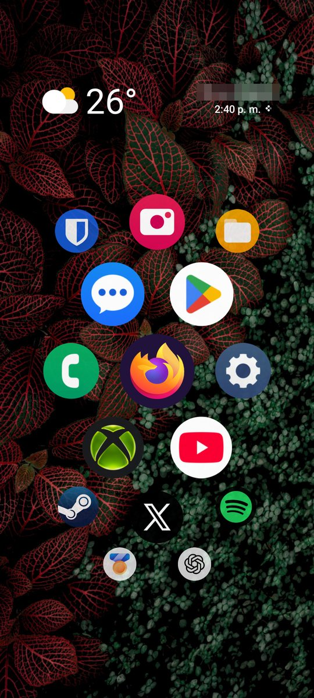
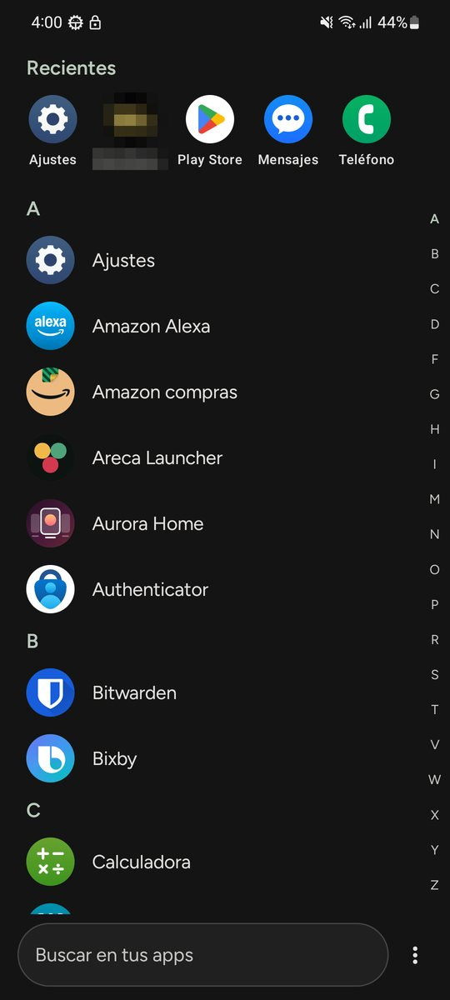
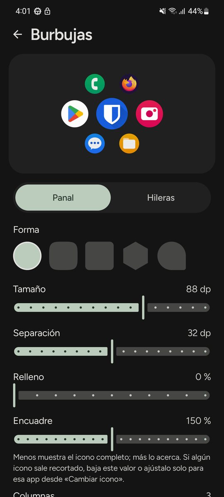
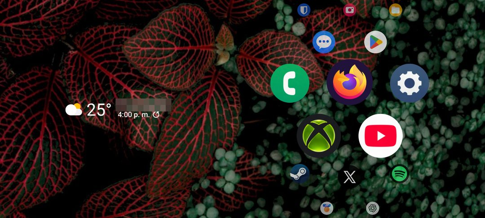
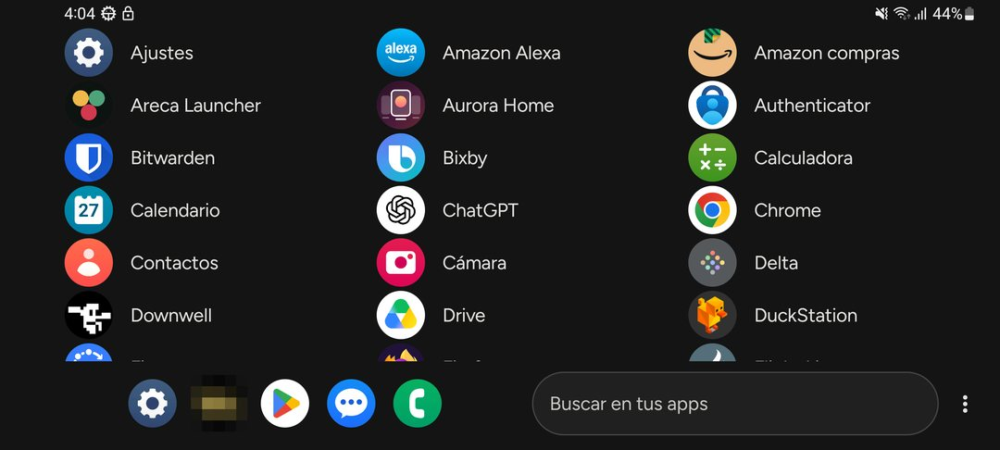
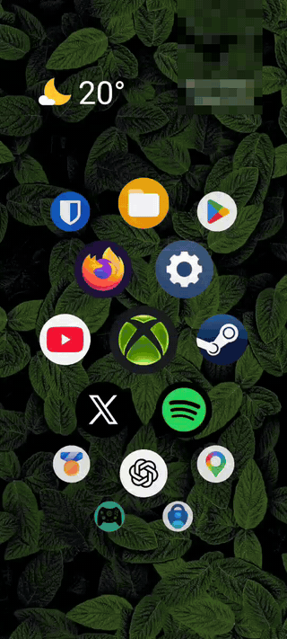
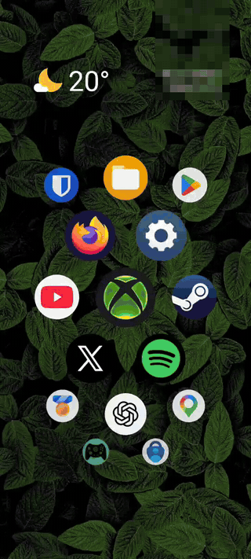
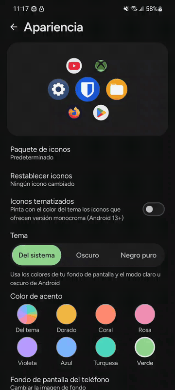
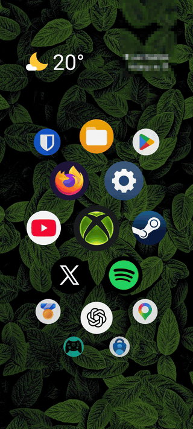

# Areca Launcher

🇬🇧 [English](README.md) · 🇲🇽 **Español**

Launcher para Android escrito en Kotlin con Jetpack Compose. Muestra tus apps favoritas como burbujas en un panal
que se desplaza en vertical, con efecto de lupa hacia el centro, o en hileras rectas.

> Estado: en desarrollo. Probado en un Samsung con Android 13; falta probarlo en más equipos y versiones.

## Capturas

| Escritorio | Listado de apps | Ajustes |
|:---:|:---:|:---:|
|  |  |  |

| Escritorio en horizontal | Listado en horizontal |
|:---:|:---:|
|  |  |

### En movimiento

| Escritorio: lupa y atajos | Cajón: letras y desplazamiento rápido | Apariencia: tema, acento e iconos | Fondos |
|:---:|:---:|:---:|:---:|
|  |  |  |  |

## Qué hace

- **Escritorio de burbujas** en panal (por defecto) o en hileras; columnas, tamaño, separación, relleno y encuadre
  configurables, y cinco formas de icono. Opcionalmente las burbujas se deslizan al inclinar el teléfono (acelerómetro, sin permisos).
- **Favoritas, carpetas y ocultas**: reordenar arrastrando, agrupar en carpetas, ocultar apps.
- **Iconos**: paquetes de iconos instalados (ADW/Nova, con fondo y máscara del paquete para las apps que no cubre), iconos tematizados monocromos de Android 13, icono distinto por app o desde la galería, y encuadre por app.
- **Widgets** dentro del escritorio, arriba o debajo de las burbujas; en horizontal van en su propia columna.
- **Listado de apps** con búsqueda, recientes, y en vertical separado por letra con barra de navegación rápida.
- **Gestos** (opcionales): doble toque para bloquear, deslizar hacia abajo para las notificaciones y deslizar desde
  abajo para las apps abiertas. Usan un servicio de accesibilidad que solo ejecuta esas acciones.
- **Insignias de notificaciones** (opcionales): solo cuentan cuántas hay por app; no leen su contenido.
- **Tema**: del sistema (Material You, claro u oscuro), oscuro o negro puro (AMOLED), con color de acento a elegir.
- **Fondo**: el del sistema, una imagen de tu galería, colores lisos o degradados, con oscurecimiento ajustable.
- **Respaldo** de la configuración a un archivo, e idiomas español e inglés.

Nada sale del teléfono: la app no usa internet ni envía datos.

## Compilar

Requisitos: Android Studio reciente (o JDK 17+ y el SDK de Android con la API 35) y un dispositivo o emulador con
Android 8.0 (API 26) o superior.

```bash
./gradlew assembleDebug      # APK de depuración
./gradlew installRelease     # instala la versión de producción en el dispositivo conectado
```

Notas:

- `local.properties` (ruta del SDK) lo crea Android Studio y no se sube al repositorio.
- La variante `release` está firmada con la clave de **depuración**, solo para probar el rendimiento. Para publicar
  hay que configurar una clave de firma propia.
- Al compilar o instalar, el contador de [`version.properties`](version.properties) sube solo. La versión sigue el
  formato `AA.MM.N` (año, mes y número de compilación del mes); el nombre en clave está en
  [`app/build.gradle.kts`](app/build.gradle.kts).

## Estructura

```
app/src/main/java/com/areca/launcher/
  data/   ajustes (DataStore), apps, iconos, widgets, respaldo, carpetas
  ui/     pantallas (escritorio, listado, ajustes), temas y componentes de Compose
```

## Tecnología

Kotlin 2.0, Jetpack Compose (Material 3), DataStore, AppWidgetHost y LauncherApps. Gradle 8.11 con Android Gradle
Plugin 8.9.

## Licencias de terceros

Ver [`LICENSES.md`](LICENSES.md).

## Autor

Erick Castro, 2026.
